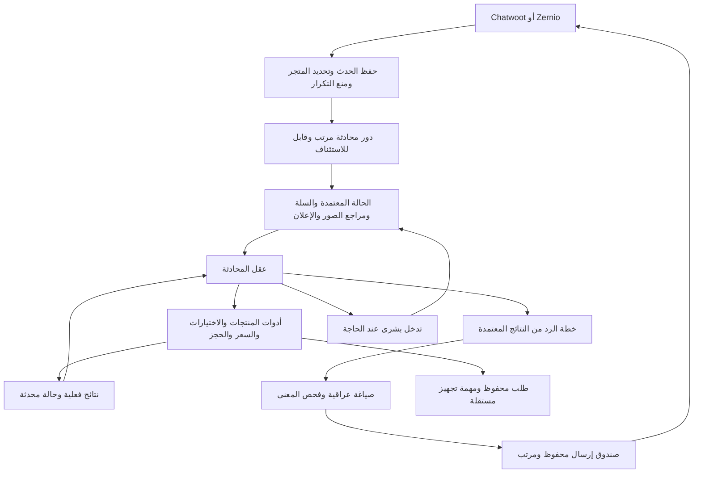

# خطة إعادة بناء قلب البيع والمحادثة في inqaa

الحالة: بدأ التنفيذ بطلب المالك في 10 نوفمبر 2026، على `codex/sales-runtime-foundation`. اعتماد التنفيذ لا يعني أن المحرك الجديد أصبح جاهزًا للإنتاج. راجع [سجل التنفيذ](2026-11-10-sales-rebuild-progress.md) لمعرفة المنجز والاختبارات والمتبقي.

مرجع البحث: [المشاريع والأدلة والحدود](2026-11-10-sales-rebuild-research.md).

## 1. الهدف وحدود النسخة الجديدة

نريد محادثة تفهم طلب الزبون وتساعده على الاختيار، وتحفظ الطلب الصحيح فور اكتمال نية الشراء وبيانات التنفيذ، مع أسلوب موظفة متجر عراقية وفق دفتر المالك. المطلوب زيادة الحجوزات الصحيحة التي يمكن تجهيزها، وتقليل التكرار والتوقف؛ لا يكفي تحسين النص أو زيادة عدد الطلبات المحلية غير القابلة للتجهيز.

نبني محرك بيع جديدًا داخل التطبيق الحالي. تبقى صفحات الإدارة والصلاحيات والمنتجات والقنوات والطلبات القديمة. نستبدل تدرجيًا تفسير السياق وتكوين السلة ومسار القرار، بدل إضافة طبقات جديدة فوق جميع المسارات القديمة.

مرجع الكود الذي بُنيت عليه الخطة: `aaf5cf81b09e85651f6ffa5ae5b5ed1606bc3657` على الفرع المحلي `codex/server-baseline-nov10`. طابق هذا المرجع السيرفر في المراجعة السابقة؛ لم يُفحص نشر الإنتاج من جديد أثناء كتابة الخطة. قبل التنفيذ نجلب آخر GitHub ونقارن الإصدار الحي ونراجع الفروق. تجربة Terra السابقة التي طلب المالك إهمالها تبقى منفصلة، ولا تُعاد تلقائيًا.

النظام الحالي Python 3.12 وFlask، وSQLite للعمل و`products.json` للكتالوج الفعلي. Docker يشغّل Gunicorn بعامل واحد وأربع threads. توجد مهام وذاكرة ومنع تكرار بالفعل؛ الخطة توحّدها وتصحح حدودها، ولا تفترض أن هذه الوظائف غائبة.

## 2. القرار المعماري المقترح

تطبيق واحد بوحدات مستقلة واضحة، مع عامل مهام وإرسال، وليس مجموعة خدمات متباعدة منذ البداية. عقل واحد يفسر المحادثة ويختار الأدوات، وخدمات التجارة وحدها تنفذ تغييرات السلة والطلبات والسعر.

المكتبات المرشحة: Pydantic لتعريف العقود، وLangGraph لتنظيم الدور إذا اجتاز تجربة الاستئناف، مع الموصل الحالي للموديلات خلف واجهة قابلة للتبديل. Langfuse اختياري للمراقبة. لا نستخدم Pydantic AI وLangGraph كمديرين متداخلين لنفس الدورة؛ إن رجحت تجربة Pydantic AI يكون بديلًا بقرار موثق.

SQLite تبقى في أول نسخة محدودة بعامل كتابة منظم ومعاملات قصيرة. لا ننتظر رد الموديل أو الشبكة داخل معاملة قاعدة البيانات. قبل تشغيل عدة replicas أو نقل عامل إلى خدمة لا تشارك التخزين، يلزم قرار ترحيل إلى PostgreSQL واختبار ترحيل مستقل. نقل القاعدة لا يُخلط مع أول تعديل في أسلوب الرد. لا نضيف Redis بوصفه ذاكرة تجارية ثانية.

## 3. توزيع المسؤوليات

| الجزء | يملك القرار بشأن | لا يملك |
|---|---|---|
| العقل الرئيسي | فهم المقصد، الربط بالسياق، الاقتراح المناسب، ترتيب الإجابة والخطوة التالية | اختراع سعر أو حفظ طلب بالكتابة النصية |
| حالة المحادثة | الاختيارات ومصادرها، السؤال المعلق، الاعتراض والمهمة الحالية | حقائق كتالوج تتجاوز المصدر الحالي |
| خدمة الكتالوج | هوية المنتج وصفاته وصوره ومعرفات الإعلان ونسخته | استنتاج موافقة شراء من مجرد مشاهدة |
| خدمة السلة والتسعير | كل سطر وقياسه ولونه وكميته والمجموع والخصم المسموح | تغيير اختيار الزبون صامتًا |
| خدمة الطلب | تحقق المتطلبات وحفظ مرة واحدة وتعديل مأذون | ضمان وصول المندوب أو تأكيد إرسال لم يحصل |
| الصياغة | التعبير العراقي والتقسيم والدفء | تغيير النية أو العناصر أو الحساب أو حالة الطلب |
| الإرسال والتجهيز | الحالة الحقيقية لكل عملية ومحاولاتها | افتراض النجاح من جملة الموديل |
| الموظف | تصحيح حقائق واختيارات وإجراءات ضمن صلاحياته | تعديل خفي لا ينعكس على ذاكرة النظام |

لا يوجد «مدقق ثانٍ» يعيد استخراج اللون والقياس من كامل التاريخ ثم يناقض السلة. التحقق البرمجي يقرأ السلة المعتمدة والأدلة المرتبطة بها، ويعيد أسبابًا محددة قابلة للمعالجة.

## 4. البيانات التي نحتاجها

الأسماء التالية مقترحات؛ يثبت مخططها في أول مرحلة تنفيذ بعد مراجعة الجداول الموجودة. نضيف migrations قابلة لإعادة التشغيل دون حذف القديم.

| الكيان | حقوله الأساسية | الغرض |
|---|---|---|
| `conversation_events` | store، channel/account، sender، provider_event_id، نوع، actor، وقت وقوع/استقبال، source_message_id | سجل أحداث موحد للزبون والموظف والإعلان والتسليم؛ فهرس فريد يمنع تكرار webhook |
| `conversation_states` | schema_version، state_version، applied_event_cursor، active_goal، pending_questions، objections، control_mode، engine_version | الحالة الحالية مع إصدار يحمي من تعديل قديم |
| `selection_evidence` | field، value، target_line/product/wearer، source_event، confirmed/proposed/superseded | نعرف مَن اختار ومتى ولأي قطعة؛ نقبل التصحيح ونبقي أثره |
| `carts` و`cart_lines` | cart_version، line_id، product_id، variant، size_system، size، color، quantity، wearer_ref | سلة واحدة متعددة القطع؛ الوزن والعمر والقياس حقول منفصلة |
| `presented_sets` | مجموعة العرض، asset_id، product/color، ordinal، outbox_part، delivery_state | فهم «الأول» و«الثاني» من العرض الحقيقي وليس ترتيب الكتالوج |
| `turn_runs` | turn_id، input_event_ids، state_version، attempt، model/prompt_version، phase، outcome | الاستئناف ومراقبة أين توقف الدور |
| `commerce_operations` | operation_key، type، input_digest، result، status | حفظ أثر العملية وإرجاع نفس النتيجة عند إعادة نفس الطلب |
| `outbox` | logical_reply_id، part_index، dependency، payload، provider_message_id، state | إرسال النص والصورة بالتسلسل وتفادي التكرار |
| `product_knowledge_gaps` | product/field/question، scope، staff_guidance، fact_value، provenance، state | فصل شرح طريقة الرد عن حقيقة المنتج وربط السؤال بسبب التحويل |

يُبحث أولًا عن توسيع `ai_deliveries` و`human_reviews` و`product_questions` بدل إنشاء نسخ موازية. `orders` الحالية تبقى سجل الطلبات الحقيقي؛ السلة مسودة منفصلة ولا تُعد طلبًا مثبتًا.

هوية المحادثة تشمل المتجر وحساب القناة والمرسل. لا توحد حسابات مختلفة بالاسم، ولا تستخدم رقمًا من سجل قديم تلقائيًا كعنوان الطلب الحالي دون دليل مناسب. المعرف الإعلاني يحفظ نصًا كاملًا.

الحالة ليست ملخصًا حرًا فقط: المعلومات المهمة محفوظة كحقول مع دليل. الملخص وسيلة ضغط للتاريخ، ولا يجوز أن يكتب فوق اختيار صريح أو سجل إجراء.

## 5. دورة الرسالة الجديدة

1. التحقق من المصدر وحفظ الحدث والرد السريع على webhook؛ لا ننتظر AI.
2. جمع دفعة الرسائل المتقاربة مع الاحتفاظ بمعرف كل رسالة وترتيبها. نبدأ بمهلة قصيرة قابلة للقياس، ونحدد سقفًا للانتظار بدل تأخير متكرر غير محدود.
3. قراءة مفاتيح المتجر والمحادثة وحالة الموظف. إيقاف AI لا يمنع تسجيل السياق أو الإعلان، لكنه يمنع الاستدعاء والإرسال الآلي.
4. تكوين دور مربوط بإصدار الحالة. تحديث إحالة الإعلان لا يمسح اختيارًا صريحًا أحدث، ورسالة الموظف تصبح حدثًا معروف الفاعل.
5. تحميل الحالة والسلة، آخر الرسائل، الأسئلة غير المجابة، المنتجات المشار إليها، وحقائق الكتالوج اللازمة فقط.
6. العقل يرجع قرارًا منظمًا: مقاصد الرسالة، تحديثات مقترحة بدليل، أدوات مطلوبة، والاعتراض أو الناقص الحقيقي. ليس مطلوبًا تخزين تفكير داخلي طويل؛ يكفي سبب قرار موجز قابل للتدقيق.
7. تطبيق التحديثات الصحيحة ذريًا وبنسخة متوقعة. النتيجة تعاد للعقل: تم، ناقص محدد، تعارض إصدار، غير متوفر، أو يلزم موظف.
8. لو نية الشراء ثابتة والسلة والاتصال مكتملان وغير مشروطين بشرط معلق، تستدعى أداة الحجز فورًا؛ لا سؤال موافقة إضافي بلا سبب.
9. إعداد جواب لكل سؤال مفتوح ثم خطوة بيع واحدة مناسبة. يستخدم الكاتب النتائج الفعلية، وقد يكون نفس العقل أو Gemini في التجربة المقارنة.
10. قبل الإرسال نراجع الإصدار وتدخل الموظف وأحدث الرسائل. إذا وصل تصحيح جديد، يمنع رد قديم عن اللون أو السعر؛ لا نكرر أي حفظ تم بالفعل.
11. حفظ أجزاء الرد في outbox وإرسالها حسب الترتيب. نجاح الطلب لا يُعاد عند فشل رسالة التأكيد.

التحقق من إصدار الحالة يكون عند حفظ التحديثات وعند إرسال الرد، مع lease/lock قصير لكل محادثة. لا يكفي قفل Python داخل عملية واحدة لحماية عدة عمال.

## 6. عقود الأدوات

كل أداة تأخذ سياق المتجر والصلاحية من النظام، لا من الموديل. بيانات الزبون والمنتج والإعلان تعامل كبيانات لا تعليمات. لا تمنح أداة SQL أو ملفات أو شبكة عامة للعقل.

| الأداة المقترحة | الناتج المطلوب |
|---|---|
| `resolve_product_reference` | resolved/ambiguous/not_found مع الأدلة؛ يدعم الإعلان والرسالة المعاد الرد عليها وترتيب الصور |
| `get_product` / `search_products` | حقائق بإصدار ومصدر، وخيارات تحقق الجمهور والفئة والمقاس والميزانية |
| `get_product_media` | assets فعلية للمنتج/اللون؛ لا عبارة «أرسلت» قبل قبول الإرسال |
| `apply_selection_changes` | تعديل أسطر محددة مع source_event وexpected_version، دون إفساد بقية السلة |
| `quote_cart` | السعر والعرض والخصم والتوصيل والمجموع من الحساب البرمجي وquote_version |
| `get_checkout_readiness` | ready أو missing_fields أو unresolved_conditions، بأسباب قابلة للعرض للموظف |
| `commit_order` | order_id والمجموع والحالة، أو رفض محدد؛ مفتاح العملية صادر من النظام |
| `request_order_change` | applied/pending_external/needs_human/rejected؛ لا ادعاء تنفيذ قبل النتيجة |
| `get_order_status` | حالة الطلب المحلي والتجهيز والتسليم كل على حدة |
| `create_handoff` / `create_knowledge_gap` | مراجعة مترابطة لا مكررة، مع السلة والسؤال المطلوب وإجراء الاستئناف |

شكل نتيجة موحد: `status`, `error_code`, `field_path`, `retryable`, `state_version`, `facts`, `missing_fields`, `operation_id`. لا يحوّل كل رفض إلى نص جاهز يسأل الزبون عن نفس الشيء.

مفتاح الحجز مشتق من المحادثة والسلة وإصدارها وحدث الموافقة المنطقي، وليس UUID جديدًا يولده الموديل بكل محاولة. طلب جديد بعد اكتمال القديم يحتاج نية جديدة وسلة جديدة؛ تعديل القديم لا ينشئ طلبًا آخر.

حفظ الطلب ونتيجة العملية ومهمة التأكيد/التجهيز يتم ضمن معاملة محلية واحدة. الاستدعاءات الخارجية بعد commit. انقطاع السيرفر بعد commit يُستعاد بقراءة النتيجة المسجلة.

## 7. قواعد المنتجات والبيع الخاصة بالمتاجر

- الربط بالمعرف الإعلاني الدقيق داخل المتجر يسبق التخمين البصري. الإعلان قد يربط مجموعة؛ لا يُجبر على منتج واحد إذا كان متعدد المنتجات.
- إذا صححت الزبونة المنتج أو أرسلت صورة لمنتج آخر، يتحول التركيز دون مسح أسطر السلة الأخرى.
- الصور: تصنيف sticker/صورة منتج/مرجع غير واضح، ثم مطابقة بمرشحين من المتجر. درجة الثقة وحدها لا تكفي؛ نحفظ دليل المطابقة وتعارض اللون أو المنتج.
- أسماء الألوان الدارجة تحتاج alias معتمدًا على المنتج؛ «خمري» قد يقابل ماروني عند منتج، لكن لا نعمم مساواة كل لونين متقاربين. البديل يحتاج اختيار الزبون.
- قياس الملابس، عمر الطفل، قياس القدم، الوزن والأبعاد أنواع منفصلة. «١٣٠» لا تقص إلى «١٣»، ولا تُفسر كل قيمة بعد «قياس» كعمر.
- الحقيبة ذات size_system=none لا تسأل عن وزن أو قياس. ملحقات الطقم تعتمد bundle_contents موثقة، لا مجرد وجودها بالصورة.
- حقائق السعر والتوصيل ووحدة البيع والعرض تؤخذ من بيانات المتجر الحالية. سعر الدرزن لا يعرض كسعر قطعة.
- سياسة الخصم التي طلبها المالك: الطلب متعدد القطع، بطلب الزبون، حتى 2000 دينار للطلب وفق إعداد معتمد؛ لا خصم متكرر مع كل مساومة. فوق الحد يكون رد لطيف يكمل البيع، لا تحويل تلقائي. قبل تفعيلها نوحد ترتيب الخصم مع العروض ونعرضه في الإعدادات؛ لا نفترض أن التجربة السابقة فعّلتها في الإنتاج.
- الرقم والعنوان الصحيحان يُحفظان عند ورودهما بأي ترتيب. لا يعتبر كل ما بعد المحافظة نقطة دالة؛ نقبل العنوان الكافي وفق احتياج التجهيز، ونسأل فقط عن نقص فعلي.
- بيانات صحيحة قد تُراجع فقط عند تناقض حقيقي أو طلب تغيير؛ منع التكرار ليس منع الاستيضاح الضروري.
- سؤال «إذا أوصي اليوم، شوكت يوصل؟» استفسار مدة، وليس اشتراط وصول اليوم. الموعد المضمون يحتاج مصدرًا تشغيليًا.
- الحجز بلون غير محسوم يتبع سياسة hold_for_color المعتمدة: حفظ للمراجعة مع منع التجهيز عند السماح بذلك، ولا نختار لونًا عشوائيًا. إذا الزبونة ما زالت تقارن، لا نعتبرها اشترت.
- رسالة تأكيد الطلب المعتمدة من المالك محفوظة كقالب إجراء منفصل، وتخرج بعد نجاح الحفظ. لا يعيد الكاتب اختصارها أو تغيير سياسة الفحص.

## 8. أسلوب الرد والموديلات

صوت عراقي قريب وفق دفتر المالك، مع التحية أول المحادثة، وفئة المنتج عند الحاجة، وفهم الاعتراض قبل طلب البيانات. نشرح الفائدة المرتبطة بالحاجة، ونستخدم عرضًا وطمأنة حقيقيين. لا ندرة وهمية ولا وعد قماش أو شحن غير مثبت.

خطة الرد تحتوي: أسئلة يجب إجابتها، facts مسموحة، إجراءات نجحت، معلومات لا يجوز طلبها مجددًا، خطوة تالية مناسبة، وصور مع ترتيبها. تقسيم 1–5 أجزاء عند الحاجة حد تصميم أولي قابل للاختبار، وليس هدفًا لإرسال خمس رسائل؛ نراعي حجم النص وحدود القناة، ولا نكرر السؤال في كل جزء.

خيارات المقارنة المعزولة:

| التجربة | القرار والصياغة | لماذا نجربها؟ |
|---|---|---|
| A | موديل واحد يفهم ويستخدم الأدوات ويكتب | أقل انتقالات وتأخير، وخط أساس موحد |
| B | عقل مختار + Gemini للصياغة العراقية | اختبار تحسن اللهجة دون تغيير القرار |
| C | A مع مستشار عند تعارض محدد فقط | قياس قيمة الاستشارة بدل إضافتها لكل دور |

لا تتغير أسماء الموديلات الحية بهذه الخطة. اختيار العقل يعتمد على أداء نفس الحالات، لا على اسم أو تقييم سابق على هيكلة مختلفة. الإعدادات المقترحة: engine_mode، decision_model، writer_enabled، writer_model، vision_model، consultant_enabled/model، rollout_percent، timeout/cost budget. صلاحية تغييرها للمالك، مع سجل تغييرات وإصدارات.

المستشار لا يملك ذاكرة منافسة أو أداة حفظ مستقلة؛ يعيد اقتراحًا للعقل من نفس الحالة. فشل استشارة لا يمسح السلة. معلومة منتج غير موجودة لا تصبح صحيحة بموافقة موديل ثانٍ.

نسخة writer لا تملك أدوات كتابة. تحفظ الأرقام والخيارات ونتيجة الإجراء، ويفحص التطابق الدلالي. إذا فشلت الصياغة يمكن استعمال مسودة العقل إذا كانت سليمة ومعتمدة، أو رد إجراء معتمد عند توفره؛ لا نحول فشل الصياغة إلى سؤال كتالوج أو نجاح مختلق.

## 9. التوقف والتدخل البشري والإرسال

| الحالة | التصرف المطلوب |
|---|---|
| 401/402 من المزود | حادثة خدمة واضحة للموظف، حفظ الدور والسياق، وعدم إعادة محاولات بلا حدود أو سؤال الزبون عن بيانات لا علاقة لها بالخطأ |
| 429 أو timeout قبل أي أثر | إعادة محدودة بمهلة، ضمن سقف زمن/كلفة؛ بديل موديل فقط إذا اعتمده المالك واختُبر |
| timeout بعد استدعاء حفظ محلي | قراءة commerce_operations قبل أي محاولة جديدة |
| إرسال خارجي غير محسوم | حالة delivery_unknown؛ مصالحة مع إيصال/استعلام المزود إن متاح، لا إعادة عمياء |
| رفض تجهيز 422 | الطلب المحلي يبقى محفوظًا، مشكلة mapping ظاهرة للموظف، لا إعادة إنشاء ولا ادعاء شحن |
| حقيقة منتج ناقصة | سؤال معرفي مرتبط بالموديل والحقل وتحويل صامت وفق سياسة المالك؛ لا نص «البيانات غير واضحة» |
| طلب موظف صريح | تسليم مباشر؛ لا محاولة مستشار لإبقاء الزبون مع البوت |
| موظف يتدخل أثناء التوليد | إبطال الرد الآلي غير المرسل وتحديث ownership والحالة |
| إغلاق مراجعة | حل السبب أو تحويلها لمسار واضح؛ لا تختفي مراجعة مع إجراء عالق، ولا تعود شارة قديمة بعد نجاح الإغلاق |

مهمة الاستئناف تعرض هل ستستكمل سؤالًا، أو تعيد توليد رد غير مرسل، أو تحتاج مصالحة إرسال. تشغيل المفتاح لا يعيد تاريخ المحادثة كله ولا ينشئ حجوزات قديمة.

## 10. الربط بملفات المشروع الحالي

مسارات الملف هنا نسبية لجذر المستودع. الدوال أُثبت وجودها في مرجع الكود المذكور؛ مواضع الأسطر قد تتغير.

| الموجود | المعالجة المخططة | البديل/الوحدة المقترحة |
|---|---|---|
| `account_app/app.py`: process_webhook / run_ai_job | إبقاء routes والواجهات، وتوجيه المحادثة إلى محرك واحد حسب الإصدار | `account_app/sales_runtime/entrypoint.py`, `runtime.py` |
| `sales_context.py`, `sales_playbook.py`, `sales_decision.py`, `sales_recovery.py` | إزالة القراءة المتنافسة من مسار v2 بعد نقل الحالات الصحيحة إلى اختبارات | `state.py`, `evidence.py`, `references.py` |
| `app.py`: call_main_ai / _call_main_ai_once / check_reply | واجهة موديل واحدة بعقود؛ تعطيل السلسلة القديمة للمحادثة المنقولة فقط | `decision.py`, `model_gateway.py`, `response_plan.py`, `writer.py` |
| `checkout.py`: chosen_color_error / order_line_error | نقل تحقق الصلاحية إلى السلة الحالية، وإزالة استخراج اختيار آخر من التاريخ | `commerce/cart.py`, `commerce/validation.py` |
| `app.py`: create_order_if_valid | استخراج حفظ الطلب في خدمة؛ لا استدعاء المسار القديم مع إعادة تفسير history | `commerce/orders.py`, `commerce/operations.py` |
| `pricing.py` | إعادة استخدام الحساب بعد تثبيت عقوده واختبار العروض؛ لا ترك الحساب للموديل | `commerce/pricing_adapter.py` |
| `ad_attribution.py`, `product_links.py`, `catalog_linking.py`, `product_variants.py` | إبقاء قواعد المطابقة المفيدة خلف repository، تصحيح parser الأنواع والمرادفات | `catalog/repository.py`, `catalog/resolve.py` |
| `vision_payload.py`, `inbound_media.py`, `product_albums.py` | موصلات ونتائج منظمة مرتبطة بالدور والمنتج/الأصل | `catalog/media_adapter.py` |
| `chatwoot.py`, `zernio.py` | تطبيع inbound/outbound/echo/referral/delivery، فحص ما يدعمه كل مزود فعليًا | `sales_runtime/events.py` مع adapters الحاليين |
| `ai_jobs.py`, `ai_transport.py`, `delivery_state.py` | توحيد العملية والإعادة وترتيب الأجزاء فوق المتاح؛ لا إعادة شبكة داخل commit | `operations/turns.py`, `operations/outbox.py` |
| `order_actions.py`, `manual_checkout.py` | نفس خدمات التجارة للموظف والبوت مع اختلاف الصلاحيات | `commerce/order_changes.py` |
| `product_questions.py`, human_reviews وdashboard | ربط التحويل بالسبب وعرض الحالة والسلة والسؤال الناقص | `operations/handoff.py` وتحديث محدود للواجهة |
| `tools/evaluate_sales_dialogues.py` وبقية المحاكيات | إعادة استخدام runner/reporting بعد منع اتصال التسليم والتجهيز | `tools/evaluate_sales_runtime.py` ومجموعة fixtures جديدة |

مجلدات sales_runtime/commerce/catalog/operations المقترحة داخل `account_app/`؛ تثبت الأسماء النهائية عند التصميم. لا نحذف الوحدات القديمة حتى ينتهي انتقال المحادثات واختبار الرجوع.

## 11. مراحل التنفيذ وطلبات الدمج

| المرحلة | المخرجات | شرط الانتهاء قبل التالية |
|---|---|---|
| 0 — تثبيت الأساس | آخر مصدر مطابق للإنتاج، خريطة المسارات، أسباب التدقيق مصنفة، بيانات اختبار منقحة، قرارات العقود | كل خطأ مستهدف له حالة ودليل ونتيجة مطلوبة؛ لا خلط أخطاء قديمة قبل النشر بالحالية |
| 1 — العقود والأحداث | schemas، migrations إضافية، تطبيع events، state_version، تسجيل actor، دفتر العمليات | أحداث مكررة/متأخرة/متزامنة لا تفسد الحالة؛ لا تغيير في رد الإنتاج |
| 2 — السلة والكتالوج | CartService، CatalogRepository فوق products.json، مراجع الصور والإعلانات، typed sizes، quote | جميع حالات السلة والحساب والتصحيح الحرجة تمر بكود معزول؛ منع القراءة المتعارضة |
| 3 — محرك القرار | تجربة LangGraph محدودة، tool gateway، عقل واحد، حدود الاستدعاء، reason codes | دور كامل يقرأ ويحدث السلة ويفهم سؤالًا جانبيًا، ويستأنف بعد crash دون تكرار |
| 4 — الحجز والإرسال | order transaction، outbox، fulfillment mapping، manual adapter، handoff/resume | نجاح اختبارات الانقطاع قبل/بعد الحفظ والإرسال، وتوافق الموظف والبوت |
| 5 — أسلوب البيع | دليل تصرف من دفتر المالك، response plan، تجربة A/B/C المعزولة، تقارير محادثات كاملة | اختيار الموديل/الكاتب بدليل، وإقرار جودة اللهجة والمعنى على عينة مخفية |
| 6 — التشغيل للمقارنة | shadow على snapshots معزولة، تقرير فروق الحالة والقرارات والكلفة | لا إرسال/كتابة طلبات إنتاج من shadow؛ تفسير الفروق الحرجة وحلها |
| 7 — تجربة محدودة | محادثات جديدة مختارة بثبات، لوحة قياس، مراقبة ومفتاح توقف | استقرار فني وتحسن أو عدم تراجع تجاري على عينة كافية |
| 8 — التوسع والتنظيف | زيادة تدريجية، نقل الباقي، إزالة مسارات قديمة غير مستخدمة وتحديث Cloud handoff | انتقال قابل للتدقيق ورجوع مجرّب؛ لا محادثة عالقة بين محركين |

كل مرحلة PR مستقل على فرع `codex/` مع مخطط البيانات واختبارها. لا يلزم نشر كل PR فورًا. تقدير الجهد النسبي الأولي: 15% أساس وتقييم، 25% ذاكرة وكتالوج وسلة، 25% قرار وحجز واستعادة، 15% بيع ولهجة، 20% تجربة وقياس وترحيل. هذه نسب تخطيط للجهد وليست نسب أسباب الأعطال أو وعدًا بالتحويل؛ تعاد بعد المرحلة 0.

## 12. الاختبارات التي تمنع تكرار الأخطاء

نبدأ بمجموعة مقترحة من 120 رحلة، يراجعها الإنسان، تشمل 80 للتطوير و40 محجوبة للتقييم النهائي. نمنع تسرب نسخ لنفس المحادثة بين المجموعتين. معظم الرحلات 8–25 رسالة، وبعضها 30–50 لاختبار الذاكرة. الأعداد هدف إعداد، لم تُنفذ في هذه المهمة.

| المحور | أمثلة |
|---|---|
| اختيار وتعديل | ماروني ثم أزرق، لونان لطفلين بعمرين، حذف قطعة وإضافة أخرى، الرجوع للعرض السابق |
| بيانات متفرقة | رقم ثم سؤال ثم عنوان، عنوان ثم قياس ثم رقم، رقم ناقص، حي الأخضر ليس لون القطعة |
| أنواع المقاس | 130 لا تصبح 13، قياس85 ليس عمر85، أحذية دون وزن، حقائب دون قياس |
| إعلان وصور | معروف/مجهول/متعارض/متأخر/متعدد؛ ستيكر؛ صورة جديدة؛ أول وثالث صورة؛ صورة فشل إرسالها |
| بيع | سعر شامل، عرض قطعتين، شرط سعر، خصم ضمن/فوق الحد، تردد المقاس، انتظار، رفض، بديل بميزانية |
| حقائق | ملحقات غير موثقة، طول المنتج الفعلي، معلومات متعارضة، شرح موظف لا يتحول إلى حقيقة عامة |
| خدمات الطلب | تعديل قبل/بعد التجهيز، إلغاء، شكوى، متابعة، طلب سابق خارجي غير موجود محليًا |
| تشغيل | webhook مكرر، ترتيب وصول مختلف، تدخل موظف، AI مغلق، restart، 401/402/429، timeout، تجهيز422 |

ثلاث طبقات تحقق: اختبارات محلية للمخزن والأدوات، محادثات فعلية مع الموديلات في بيئة معزولة، ثم قياس حي محدود. تقييم الأسلوب قد يستعين بموديل حكم لكنه لا يقرر نجاح الحفظ؛ نفحص order/cart/outbox والآثار مباشرة. محاكي الزبون قد يخطئ أو يتعاون أكثر من الواقع؛ نراجع transcripts ونضيف حالات مؤلفة يدويًا وتسجيلات منقحة.

تُكرر عينة من 30 رحلة حرجة خمس مرات لكل مرشح لقياس الثبات، مع فصل نتيجة الاستدعاء الواحد عن النجاح المتكرر. تكاليف الموديلات وسقف التجربة تحسب قبل التشغيل. أي إرسال بيانات أو صور إلى مزود إضافي يلتزم بنطاق الإذن المتاح؛ لا يُعد هذا البحث إذنًا عامًا لرفع صور الزبائن.

أهداف قبول أولية، قابلة للتعديل قبل التجربة، وليست نتائج محققة:

- صفر طلبات مكررة أو تسرب بين المتاجر أو تغيير اختيارات غير مأذون في المجموعة الحرجة.
- صفر ادعاءات حفظ/تعديل/شحن تخالف النتيجة الفعلية في العينة المفحوصة.
- 100% اجتياز حالات الحساب والحفظ البرمجية الحرجة؛ أي فشل يحجب الإطلاق.
- 95% على الأقل نجاح نهاية الرحلة في حالات الموديل القابلة للإكمال ببيانات صحيحة، مع تقرير لكل محور لا متوسط يخفي ضعف الصور أو الأطفال.
- تكرار السؤال المعلوم غير الضروري أقل من 2% من الأدوار المؤهلة؛ نفصل إعادة الاستيضاح المشروعة.
- على الأقل 90% من عينة الردود يقرها المالك/مراجع عراقي من حيث الطبيعية والإجابة والخطوة المناسبة، دون كشف اسم الموديل أثناء المقارنة.
- هدف أولي p95 من اكتمال دفعة النص إلى قبول إرسال الرد ≤15 ثانية، والصورة ≤25 ثانية تحت حمل متفق عليه؛ يراجع مقابل قياس الأساس ولا يُعرض كضمان مزود.
- اختبارات حمل عند ضعف الذروة المقاسة، مع backlog وتوقف عامل وإعادة تشغيل، لا عدة محادثات متسلسلة فقط.

## 13. قياس الحجز الصحيح

نعرف جلسة البيع وقواعد إدراجها قبل المقارنة، ونخرج الرسائل الآلية والتكرار وخدمة الطلبات القديمة من مقياس التحويل الأساسي مع إظهار عددها منفصلًا. المؤشر الأساسي: الطلبات الصحيحة الجديدة / جلسات البيع المؤهلة. ونقيس أيضًا قبول التجهيز، الإلغاء، الاستلام إن توفرت بياناته، هامش الربح بعد الخصم، وزمن الموظف.

الفunnel المرئي: استفسار → منتج محدد → اختيار → بيانات اتصال → طلب محفوظ → تجهيز مقبول. لكل انتقال سبب عدم الإكمال، مع فصل تعطل التقنية عن عدم توفر المنتج أو قرار الزبون.

التجربة تتوزع على مستوى المحادثة، وبطبقات متجر/إعلان/فترة متقاربة؛ لا نبدل المحرك كل رسالة. نفصل bot-only وstaff-assisted وstaff-only حتى لا ننسب إنجاز الموظف للبوت. لا نستخدم «عدد الرسائل» وحده مقامًا، ولا نعد التشغيل المغلق ضعفًا بالموديل.

نحدد حجم العينة بعد معرفة التحويل الأساسي وحجم الفرق المطلوب؛ لا نستنتج نجاحًا من عشر محادثات. نقارن خلال دورة أسبوعية كاملة على الأقل مع انتظار نافذة الإلغاء/التجهيز، ونطيلها إذا العينة غير كافية. لا يوجد توقع رقمي موثوق للزيادة قبل هذه التجربة.

## 14. الترحيل والتراجع

- قبل canary نأخذ نسخة احتياطية متسقة من SQLite والكتالوج والإعدادات، ونختبر استعادتها في بيئة منفصلة.
- المحادثات الجديدة تبدأ بالإصدار المختار. القديمة تبقى على محركها حتى تنتهي، أو تنتقل بواسطة محول حالة يعرض الفروق دون إرسال أو حجز تلقائي.
- shadow يعمل بقاعدة وoutbox معزولين؛ العميل لا يتلقى ردين ولا تدخل نتائج المحاكاة في الذاكرة الحية.
- مرحلة الإطلاق المقترحة 5% ثم 20% ثم 50% ثم 100%، ورفع النسبة مشروط بالقياس وليس بالوقت فقط. مفاتيح AI الحية محفوظة كما هي.
- لكل محادثة كاتب واحد للحالة. لا يعمل محركان على إنشاء الطلب في الوقت نفسه.
- عند التراجع: منع الأدوار الجديدة على v2، تسوية المهام والإرسال غير المحسوم، ثم تحويل الحالة المتوافقة. ما لا يمكن تحويله يُسلّم لموظف؛ لا رجوع أعمى يمسح الاختيارات.
- migrations إضافية في البداية. لا نحذف الأعمدة أو البيانات القديمة ضمن مرحلة canary.
- قبل النشر نثبت SHA ونسخ prompts/models والعقود، وبعده نتحقق من بصمة الصحة وحالة Railway ومؤشرات التشغيل؛ GitHub push وحده لا يثبت النشر.

## 15. قرارات محسومة وأخرى تحتاج نتيجة تجربة

محسوم في الاقتراح: سلة واحدة، دليل لكل اختيار، حقائق من المصدر، حفظ ذري، تقسيم إرسال معلوم، فصل الحجز عن التجهيز، خطوات بيع مرنة، أدوات مشتركة للموظف والبوت، واختبار نهائي للحالة الفعلية.

يتحسم بالتجربة: اسم العقل، الحاجة إلى Gemini منفصل للصياغة، جدوى المستشار، اعتماد LangGraph بعد spike، توقيت نقل القاعدة، والحاجة إلى بحث متجهي. عدم حسمها لا يمنع تصميم العقود ومجموعة الاختبار؛ يمنع فقط تثبيت اختيار مكلف دون قياس.

أول عمل عند اعتماد التنفيذ: المرحلة 0 ثم عقد الحالة والسلة ومجموعة الرحلات. لا نبدأ بتغيير prompt الإنتاج أو تبديل الموديل؛ لأن نتيجة القرار يجب أن تصل إلى نفس السلة والحجز أولًا.
